# The Caro-Kann, as Eric Hansen Plays It

A practical guide to Eric's **Caro-Kann / …c6 speedrun**, built around the decisions that recur in his games: get the bishops working, challenge the centre, recognize when a pawn is genuinely loose, and turn a sound position into an easier middlegame.

[Original series](https://www.youtube.com/playlist?list=PLUjxDD7HNNTjVEZ_1I8E28uav9t_ltDKX) · [All 148 supplied games](../pgn/eric-caro-kann-games.pgn) · [22 annotated study chapters](../pgn/eric-caro-kann-repertoire.pgn) · [Sources and game index](../sources/eric-caro-kann.md) · [Stockfish review](../sources/eric-caro-kann-validation.md)

**What this guide covers.** The opening is a Caro-Kann when White establishes an e4 centre against `…c6` and `…d5`. Eric also uses the same first two moves against other openings, producing Slavs, Semi-Slavs, and occasional Stonewalls. Those belong to the wider repertoire, but they are not renamed Caro-Kanns. Eric explains this distinction in the [series introduction](https://www.youtube.com/watch?v=rCZrddCQWY8&t=7s).

The guide uses the supplied moves, opening and teaching passages from all 12 caption tracks, and Stockfish 18 checks. It is an editorial synthesis, not a verbatim course or a claim that every sentence of every video was reviewed. Game links retain the supplier's **approximate** timestamps; teaching links identify the relevant caption passage, not independently frame-verified positions. The supplied corpus includes nine games after the video's stated rating endpoint and one game whose “off camera” note conflicts with the final episode's captions; see the source index.

All 22 boards are actual positions replayed from the supplied games, shown from Black's side. Arrows illustrate pressure, candidate moves, or routes; a route may require intervening moves. A diagram of a mistake is a warning, not a recommendation. Engine alternatives are labelled separately from played moves.

## Guide map

- **Start here:** [the decision tree](#1-the-first-decision-is-whites-centre), [piece placement](#2-where-the-pieces-go-and-why-the-order-changes).
- **Main structures:** [Advance](#3-the-advance-two-ways-to-challenge-the-chain), [Exchange](#4-the-exchange-a-file-and-a-square-become-available), [Two Knights](#5-the-two-knights-pin-with-your-eyes-open), [main lines with Nc3 or Nd2](#6-nc3-or-nd2-exchange-on-e4-and-choose-a-system).
- **Other answers:** [Panov](#7-c4-the-panov-and-accelerated-panov), [early Bc4 and Qh5](#8-early-bishop-and-queen-attacks), [Fantasy and quiet d3](#9-fantasy-and-quiet-d3-setups), [the wider repertoire](#10-against-other-first-moves-the-slav-boundary).
- **Make it work:** [recaptures and pawn breaks](#11-recaptures-pawn-breaks-and-the-middlegame), [tactical checks](#12-tactics-worth-learning-and-a-sacrifice-not-to-copy), [study route](#13-a-practical-study-route), [checklist](#14-your-between-moves-checklist).

## 1. The first decision is White's centre

Start with `1.e4 c6 2.d4 d5`. Black attacks e4 while keeping the c8-bishop's diagonal available. The next position decides the rest:

| White's choice | Eric's recurring response | Your next question |
| --- | --- | --- |
| `3.e5` | `3…Bf5`, or the immediate `3…c5` | Where will the g8-knight go, and when can you attack d4? |
| `3.exd5` | `3…cxd5` | Does White use `Nc3`, `Bd3/c3`, or `c4`? |
| `3.Nc3` / `3.Nd2`, with a pawn on d4 | Usually `3…dxe4 4.Nxe4` | Choose `…Bf5`, `…Nd7`, or `…Nf6`; they are different systems. |
| `2.Nf3 d5 3.Nc3` | `3…Bg4` | Exchange on f3 after h3, or calculate the sharper retreat line? |
| `2.Nf3 d5 3.e5` | `3…Bg4`, then `…e6` and `…c5` | Has the early knight move given the bishop a useful pin? |
| Early `Bc4` | `…d5`, usually followed by `…cxd5` after an exchange | Can White justify the time spent moving the bishop again? |
| `3.f3` | Eric tries `3…e6` | Are you entering a French-like centre rather than the normal outside-bishop setup? |
| Quiet `d3` / `Nd2` | Develop with `…Bg4`, or occupy the centre with `…e5` | Can White challenge d5 or e5 immediately? |
| Early `c4` | A Panov or Accelerated Panov structure | Is d4 isolated, and does White have enough activity to compensate? |

This is a decision tree, not a premove script. Even Eric's first episode interrupts the usual sequence against `2.Qh5`: he plays `2…Nf6`, attacking the queen and e4, then takes central space. See [the explanation](https://www.youtube.com/watch?v=rCZrddCQWY8&t=662s) and game 3.

## 2. Where the pieces go, and why the order changes

Eric repeatedly develops the **light-squared bishop before `…e6`** when the position allows it. The bishop often goes to g4 when there is a useful knight to pin, or f5 when that square is safe. Then `…e6` supports d5 and opens the f8-bishop. This is particularly clear in his [development explanation](https://www.youtube.com/watch?v=YDUfNGkU3GA&t=1360s).

The useful defaults are:

| Piece | Typical destinations | Condition that changes the plan |
| --- | --- | --- |
| c8-bishop | f5 or g4; retreat through g6 to h7 | `Qb3`, `h4/g4`, or a tactical threat may make immediate development wrong. In the `…Nd7` system it often develops later via b7. |
| b8-knight | c6 after the c-pawn leaves; d7 while c6 is occupied | A pin on c6, an occupied d7, or another knight's intended route may change the order. |
| g8-knight | f6 in open centres; e7 or h6 against a white pawn on e5 | e5 controls f6. A knight on e7 must not obstruct an undeveloped f8-bishop without a reason. |
| f8-bishop | d6 for activity; e7 for a quieter development; g7 in an Exchange setup | A pinned e6-pawn can make a routine `…Bd6` tactically wrong. |
| Queen | b6 to pressure d4/b2; c7 for coordination | An early queen trip can cost time. Count defenders and checks before taking a pawn. |
| Rooks | c8 on a half-open c-file; e8 on a useful e-file | The h- or g-file may become more valuable after a pawn recapture. |

Eric's simple idea is sound: make the pieces useful. The exception is equally important: **a developing move must still answer the position's threats.**

## 3. The Advance: two ways to challenge the chain

### A. `3…c5`: attack the base immediately

`1.e4 c6 2.d4 d5 3.e5 c5`

Black has spent two moves getting the c-pawn to c5, but immediately questions d4. In game 1 Eric meets `4.dxc5` with `4…e6`, then recovers with `…Bxc5`. White's d-pawn has disappeared; Black has not merely lost a pawn for nothing. [Eric introduces both Advance choices here.](https://www.youtube.com/watch?v=rCZrddCQWY8&t=76s)

  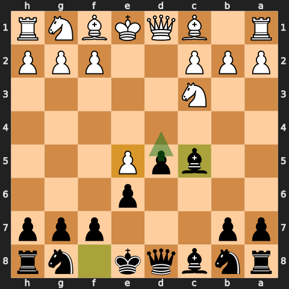
  
<strong>Advance: challenge the centre immediately.</strong> After 5...Bxc5: the c-pawn has been exchanged for White's d-pawn. Develop and pressure e5; this is not the ...Bf5 structure.

If White keeps the chain with c3, maintain the tension unless an exchange does something useful. In game 89 Eric explains that an early `…cxd4 cxd4` releases c3 for the white knight. He waits, develops, and exchanges when the resulting squares become useful. [See the explanation at 8:10.](https://www.youtube.com/watch?v=qRgmW6SW_b0&t=490s)

That is a decision rule, not “never exchange”: compare the pressure you retain with the square or tempo you gain by taking.

### B. `3…Bf5`: develop first, then undermine d4

`1.e4 c6 2.d4 d5 3.e5 Bf5 4.Nf3 e6 5.c3 c5`

The bishop is outside the pawn chain before Black closes it. The position can look French-like, with a much freer light-squared bishop. The next tasks are `…Nc6`, pressure on d4, and a sensible route for the kingside knight. [Game 84 explains the central aim.](https://www.youtube.com/watch?v=VEl-6jrdpDA&t=3030s)

  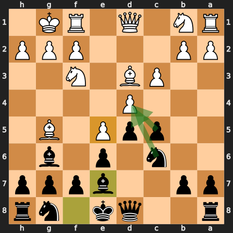
  
<strong>Advance: bishop outside the pawn chain.</strong> After 8...Nc6: pressure d4 with the c5-pawn and knight. The g8-knight still needs a route that respects e5.

**Do not put a knight on f6 just because that is its usual developing square.** White's e5-pawn attacks it. Eric uses `…Nge7-f5` and `…Nh6-f5`; the choice depends on whether the bishop has developed, whether White can play g4 with tempo, and where the other knight belongs.

When White plays Nf3 before d4, Eric often uses `…Bg4` instead. Game 12 gives the clear model:

`1.e4 c6 2.Nf3 d5 3.e5 Bg4 4.d4 e6 5.Be2 c5 6.O-O Nc6 7.c3 Nge7 8.Be3 Nf5`

  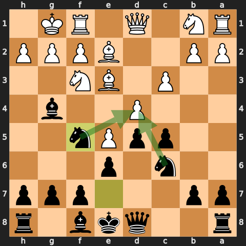
  
<strong>Early Nf3: the ...Bg4 route.</strong> After 8...Nf5: the knight has used e7 because e5 controls f6. Both knights bear on d4.

In game 28 he explicitly notices that a knight arriving on f5 can interfere with the h5-bishop's retreat. He exchanges on f3 before using f5. Learn the reason for the move order, not just the final knight square. [Explanation.](https://www.youtube.com/watch?v=tyFiLrOpKYg&t=2170s)

### C. `h4` and `g4`: bishop safety is a real calculation

After `1.e4 c6 2.d4 d5 3.e5 Bf5 4.h4`, Eric uses `4…h6` in game 55. It provides h7 as a retreat square if the bishop goes through g6. [He explains the purpose at 49:40.](https://www.youtube.com/watch?v=HI0Q1obUbXA&t=2980s)

  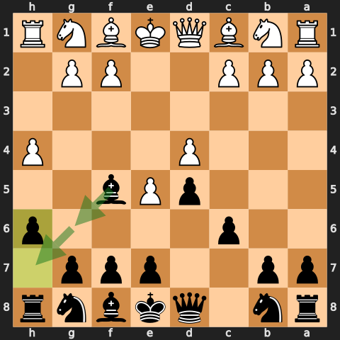
  
<strong>Advance h4: give the bishop a retreat.</strong> After 4...h6: h7 is available if the bishop retreats through g6. White can still expand; this move is not a ban on g4.

Against an immediate g4 he also tries `…Be4` in game 64, and against a different move order retreats all the way to c8 in game 108. Neither example justifies a universal bishop-retreat rule. Check h4-h5, f2-f3, whether your bishop can escape, and whether you can answer a wing attack in the centre.

The losses to Jetsurgeon (game 64) and exterminator444 (game 120) are useful here. White can gain genuine space and initiative. They are not proof that the initial bishop development is unsound: in game 120 Eric emphasizes exchanging pieces to reduce the impact of the space advantage, and the result is decided much later. [That discussion starts around 18:20.](https://www.youtube.com/watch?v=FmT5SkOnEHE&t=1100s)

### D. White adds `c4`: the d5-square becomes a resource

Games 41 and 113 show another plan. Black develops with `…Ne7` and `…Nd7`, exchanges `…dxc4`, then uses `…Nb6` to gain time against the bishop. The e7-knight can occupy d5.

  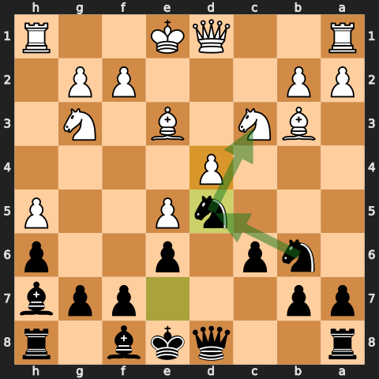
  
<strong>Advance c4: occupy d5 with a piece.</strong> After 12...Ned5: ...dxc4 and ...Nb6 cleared d5 for the e7-knight. The remaining d4-pawn is a potential target.

White's d4-pawn is now a potential long-term target. First finish development and make the central blockade work; do not assume that an isolated or backward-looking pawn can simply be collected. [Eric explains the target in game 113.](https://www.youtube.com/watch?v=Y0LtCzfbdwA&t=570s)

## 4. The Exchange: a file and a square become available

`1.e4 c6 2.d4 d5 3.exd5 cxd5`

The recapture does two jobs: it keeps a pawn in the centre and vacates c6 for the knight. Black also receives a half-open c-file. White has a half-open e-file, so this is not a free structural advantage.

### A. White develops Nc3 without c4

A recurring model is `…Nc6`, a bishop on f5 or g4, `…e6`, `…Bd6`, and castling. In game 29, `…Nge7` allows `Bxf5 Nxf5`, improving a knight instead of doubling a pawn.

  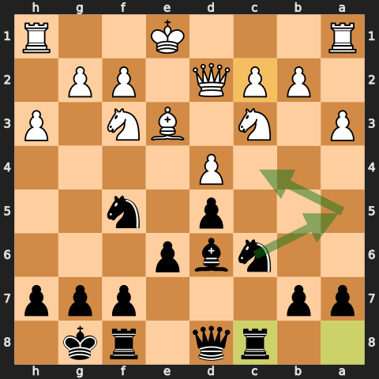
  
<strong>Exchange with Nc3: active bishops and the c-file.</strong> After 11...Rc8: c6 has become available for the knight and the c-file is half-open. ...Na5-c4 is a possible later route.

After development, `…Rc8` uses the c-file. If c4 is available, the knight may travel `…Na5-c4`, attacking useful targets and inviting an exchange that opens more files. Eric explains both the choice of rook file and the route in [game 29](https://www.youtube.com/watch?v=tyFiLrOpKYg&t=2540s).

A white bishop on b5 does not automatically make Nc6 a weakness. Sometimes `…Rc8` adds the required defender. Sometimes `…a6` asks White to surrender the bishop pair. If Black recaptures `…bxc6`, the new c6-pawn reinforces d5 and may later advance to c5.

### B. White plays Bd3 and c3

This is more purposeful than simply developing Nc3: White supports d4 and places the bishop actively. Eric demonstrates a fianchetto with `…Nc6`, `…Nf6`, `…g6`, `…Bg7`, and `…O-O` in games 75 and 90.

In game 90 he inserts `5…Qc7` to make Bf4 less convenient, then develops. Later `…Bf5 Bxf5 gxf5` accepts doubled f-pawns for control of e4 and an open g-file. [His explanation distinguishes those benefits from the structural cost.](https://www.youtube.com/watch?v=qRgmW6SW_b0&t=750s)

  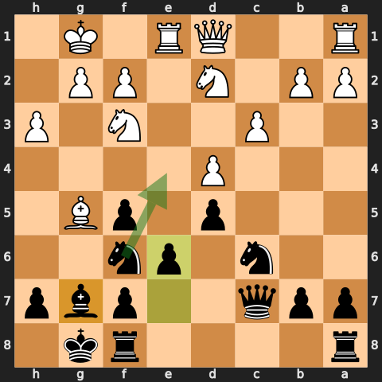
  
<strong>Exchange Bd3 and c3: the fianchetto plan.</strong> After 12...e6: the doubled f-pawns help control e4 and the g-file is open. Both kings are castled; king safety still needs calculation.

Do not call the doubled pawns “good” without saying what they do. The pawn on f5 controls e4; the pawn on f7 remains a separate pawn; the g-file becomes available for a rook. Black may use `…Kh8`, `…Rg8`, or `…Ne4`, but king safety and White's central play decide the order.

### C. The pin exception: do not copy a developing move blindly

In game 20 the position after

`1.e4 c6 2.d4 d5 3.exd5 cxd5 4.Nc3 Nc6 5.Bb5 Bf5 6.Nf3 e6 7.Qe2`

contains **two pins**. Bb5 pins Nc6 to Ke8; Qe2 pins the e6-pawn to Ke8. If Black now plays `7…Bd6`, White has `8.Nxd5`: `…exd5` would expose the king to Qe2 and is illegal. Eric spots this danger in the [video explanation](https://www.youtube.com/watch?v=YDUfNGkU3GA&t=3380s).

  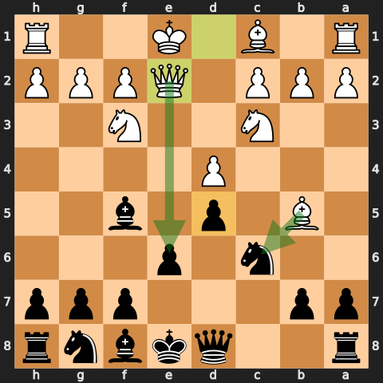
  
<strong>Exchange: two pins change development.</strong> After 7.Qe2: Nc6 is pinned by Bb5 and the e6-pawn is pinned by Qe2. The study variation uses ...Ne7 instead of Eric's ...Nf6.

**Engine refinement:** Eric chooses `7…Nf6`, but Stockfish finds it less precise than alternatives including `7…Ne7`. The study separates the played move from that suggested improvement. The correct lesson is to resolve the pins before proceeding with the standard setup, not to memorize `…Nf6` as the answer to every pin.

## 5. The Two Knights: pin with your eyes open

`1.e4 c6 2.Nf3 d5 3.Nc3 Bg4`

Eric's recurring plan is to develop the bishop before `…e6`. After `4.h3`, the simpler route is `4…Bxf3 5.Qxf3 e6`, as in game 7. White has the bishop pair; Black has a compact centre and straightforward development. [Eric presents this as a practical choice.](https://www.youtube.com/watch?v=rCZrddCQWY8&t=2000s)

  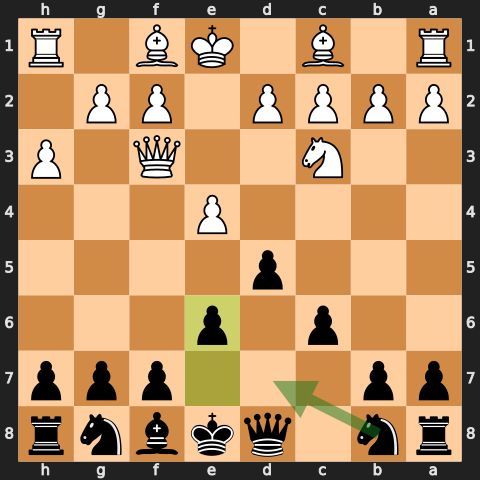
  
<strong>Two Knights: the simple bishop exchange.</strong> After 5...e6: Eric has exchanged the g4-bishop for the knight. Black is solid but White owns the bishop pair.

Keeping the bishop with `…Bh5` is also part of the run, but invites g4 and tactical disputes about the pin. Game 23 is the essential warning:

`1.e4 c6 2.Nf3 d5 3.Nc3 Bg4 4.exd5 cxd5 5.h3 Bh5 6.Bb5+ Nc6 7.Ne5 Bxd1 8.Nxc6`

  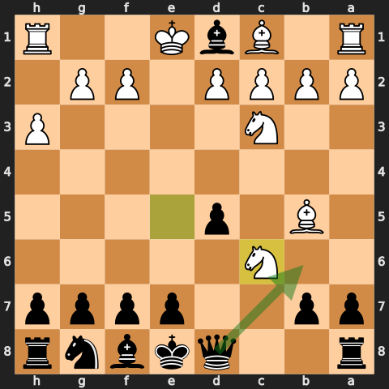
  
<strong>Two Knights: do not recapture automatically.</strong> After 8.Nxc6: the knight attacks Qd8 and the c6-knight is gone. ...Qb6 is the tactical escape; ...bxc6 is the game's mistake.

The tempting `8…bxc6?` allows `9.Bxc6+ Qd7 10.Bxd7+ Kxd7 11.Kxd1`, leaving Black a pawn down. Eric wins the game later, but that does not repair the opening mistake.

**Crucial correction:** `6…Nc6` is not refuted, and `7.Ne5` is not a sound universal queen-sacrifice trap. Black has **`8…Qb6!`**. A checked continuation is `9.Ne5+ Kd8 10.Nxf7+ Kc8 11.Kxd1 d4`, with advantage to Black at the recorded search limits. White has other choices; this is an illustrative line, not a claim of forced play throughout.

Eric himself revisits the position and identifies the queen move in the [post-game analysis](https://www.youtube.com/watch?v=tyFiLrOpKYg&t=822s), emphasizing that it is difficult to find over the board. Stockfish confirms the resource. Do not stop at his initial reaction and mistakenly report the whole variation as losing.

**Training rule:** when a pinned piece moves and apparently offers the queen, calculate forcing checks and intermediate moves before recapturing anything.

## 6. Nc3 or Nd2: exchange on e4 and choose a system

After `1.e4 c6 2.d4 d5 3.Nc3 dxe4 4.Nxe4`, Eric samples three substantial branches. Choose one to learn first. They do not share an interchangeable development sequence.

### A. `4…Bf5`: the Classical branch

Game 104 is the clean model:

`4…Bf5 5.Ng3 Bg6 6.h4 h6 7.Nf3 Nd7 8.h5 Bh7 9.Bd3 Bxd3 10.Qxd3 e6 11.O-O Ngf6 12.Bf4 Be7 13.c4 O-O`

  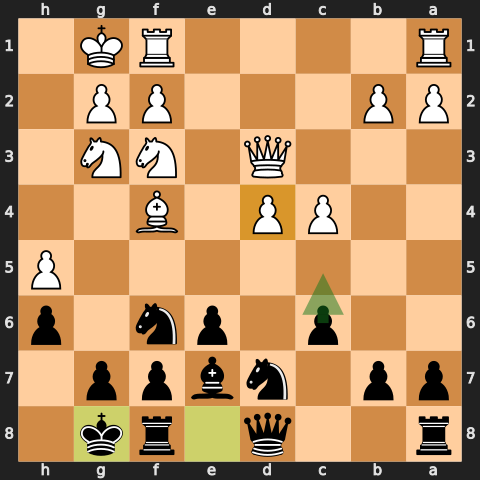
  
<strong>Classical: exchange the e4-pawn, develop the bishop.</strong> After 13...O-O: Black has completed development. White has space; the next job is to prepare a central break, not sit indefinitely.

The bishop develops before `…e6`, retreats when attacked, and exchanges on d3. Black then completes development and prepares central counterplay. White's space is real; Black's task is to challenge it without creating an immediate weakness. [Game 104's explanation.](https://www.youtube.com/watch?v=mKmkrye5lUs&t=1250s)

Game 138 demonstrates a different king decision: White castles long and Eric later does the same. That does not mean queenside castling is compulsory. Compare pawn shelter, open files, and the speed of a central break before choosing a side. [Game 138.](https://www.youtube.com/watch?v=wNuYG9_1uf4&t=3020s)

### B. `4…Nd7`: delay the bishop, keep a compact centre

The usual development is `…Ngf6`, `…e6`, and a kingside bishop move, followed by castling. With c6 still occupied, the queenside knight uses d7. The c8-bishop may later develop with `…b6` and `…Bb7`.

  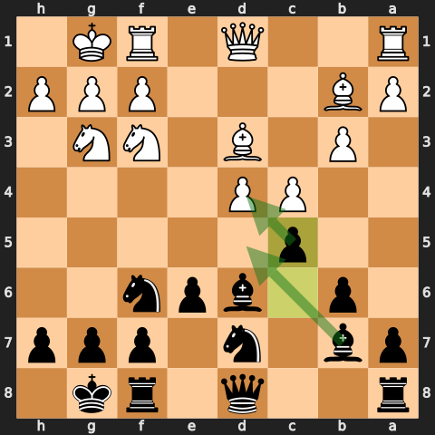
  
<strong>...Nd7: develop the c8-bishop later.</strong> After 11...c5: Black developed the bishop via b7 and challenged d4. The c6-pawn did not permanently imprison Nb8.

Game 128 shows that plan and the later `…c5` break. Eric discusses the bishop's development explicitly [around 4:30](https://www.youtube.com/watch?v=wNuYG9_1uf4&t=270s). This is a legitimate exception to “bishop out before e6.”

**Do not diagnose an opening from the result.** In game 117, after

`4…Nd7 5.Nf3 Ngf6 6.Neg5 e6 7.Bd3 Bd6`, White plays `8.Nxf7 Kxf7 9.Ng5+ Kg8`.

  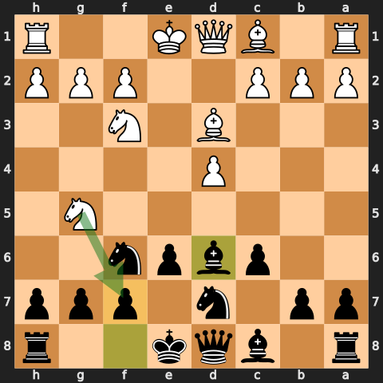
  
<strong>...Nd7: calculate the sacrifice on f7.</strong> After 7...Bd6: White can try Nxf7, but Stockfish does not support the sacrifice here. Eric's later loss is not an opening refutation.

Stockfish favors Black after accepting that sacrifice and defending accurately. Eric eventually loses, but the opening sacrifice is not thereby vindicated. Learn the defensive jobs: guard the exposed king, bring the d7-knight into the defense when useful, challenge the centre, and look for exchanges without assuming they are always available. The companion study shows `10.O-O Nf8` as one defensive continuation, separate from the played `10.f4`. [Video game and review.](https://www.youtube.com/watch?v=FmT5SkOnEHE&t=20s)

### C. `4…Nf6 5.Nxf6+ gxf6`: structural imbalance

Game 97 uses this sharper choice. Black accepts doubled f-pawns, develops `…Bf5` and `…e6`, and retains central control. The f6-pawn covers e5 and the g-file is open.

  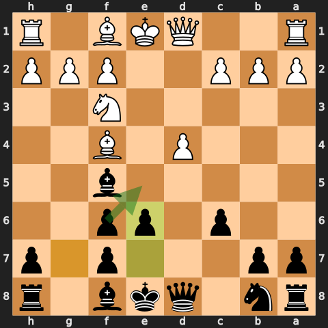
  
<strong>...Nf6 and ...gxf6: activity for structure.</strong> After 7...e6: the f6-pawn controls e5, the g-file is open, and the light-squared bishop is developed. Black must still solve king safety.

Eric notes that `…exf6` is also possible, but it produces a different pawn structure. Do not borrow a g-file attack from the `…gxf6` branch when your g-pawn has never moved. [His comparison.](https://www.youtube.com/watch?v=qRgmW6SW_b0&t=2930s)

For a first study cycle, the Classical example gives a clearer development template. The `…Nd7` and `…gxf6` games expand the repertoire once those structures are comfortable.

## 7. c4: the Panov and Accelerated Panov

A normal Panov begins `1.e4 c6 2.d4 d5 3.exd5 cxd5 4.c4`. The Accelerated Panov starts with an early c4 before White has necessarily played d4. The move orders matter.

In game 136:

`1.e4 c6 2.c4 d5 3.cxd5 cxd5 4.exd5 Nf6 5.Nc3 Nxd5 6.Nf3 e6 7.Bc4 Be7 8.O-O O-O 9.Re1 Nc6 10.d4 b6 11.Bb3 Bb7`

  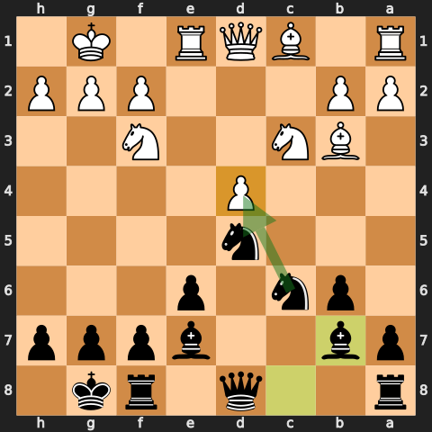
  
<strong>Accelerated Panov: activity against the isolated pawn.</strong> After 11...Bb7: White has an isolated d4-pawn but active pieces. Black develops first; an isolated pawn is a target, not a forced win.

The point of `…Nf6` before recovering the pawn is development: an early `…Qxd5` can be met by Nc3 with tempo. Eric demonstrates the queen recapture in game 82, then explains the knight recapture in [game 86](https://www.youtube.com/watch?v=VEl-6jrdpDA&t=3650s). In [game 136](https://www.youtube.com/watch?v=wNuYG9_1uf4&t=2540s), he returns to prompt recovery and an ordinary isolated-queen-pawn position after a more adventurous pawn sacrifice in game 134.

Against the isolated d4-pawn:

- Control the square in front of it, d5.
- Finish development before trying to win it.
- Expect White's active pieces, open lines, and d4-d5 break to provide compensation.
- Exchange pieces when it reduces White's activity without freeing the pawn or creating another tactical problem.

Do not describe the structure as a forced win for Black. Also distinguish the **post-series** standard Panov in game 142 from the video's Accelerated Panov examples; it is preserved in the corpus but is not evidence of a spoken lesson.

## 8. Early bishop and queen attacks

### Bc4: the Hillbilly setup

`1.e4 c6 2.Bc4 d5 3.exd5 cxd5`

Eric repeatedly obtains comfortable development here. `…d5` attacks the bishop while gaining central space; a bishop that returns to b3 has spent time and now looks at a defended d5-pawn. Black can develop `…Nc6`, use `…Nf6` or an appropriate bishop move, and castle. [Early explanation.](https://www.youtube.com/watch?v=rCZrddCQWY8&t=420s)

  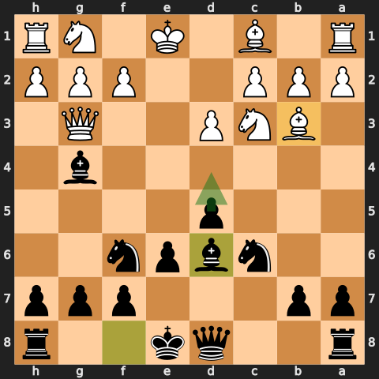
  
<strong>Early Bc4: gain a tempo in the centre.</strong> After 8...Bd6: ...d5 chased the bishop and Black developed with threats. The bishop on b3 meets a defended d5-pawn.

If White does not play d4, Black sometimes gains more space with `…e5`. But retain the calculation: in game 52 Eric admits that his bishop placement allowed White's bishop to become more useful. “The opening is comfortable” does not mean that every natural move is best. [Game 52.](https://www.youtube.com/watch?v=HI0Q1obUbXA&t=1950s)

### Qh5: answer the queen, then take the centre

Game 3 begins `1.e4 c6 2.Qh5 Nf6 3.Qf3 e5 4.Be2 d5`. The developing knight attacks the queen and e4. Black uses the time gained to occupy the centre. This is a concrete reason to interrupt the nominal `…c6, …d5` sequence.

Avoid teaching an automatic attack on White's king. Black's first reward is development and space; a mating attack needs further mistakes or a specific tactical justification.

## 9. Fantasy and quiet d3 setups

### The Fantasy: `3.f3`

Game 33 shows `1.e4 c6 2.d4 d5 3.f3 e6 4.e5 c5 5.c3 Nc6 6.Be3 Nh6`.

  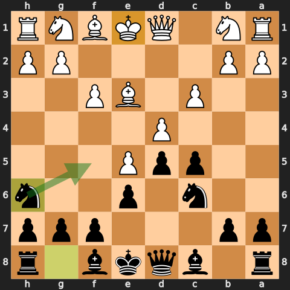
  
<strong>Fantasy: Eric's ...e6 response.</strong> After 6...Nh6: ...e6 and ...c5 produced a French-like centre. The knight eyes f5; the light-squared bishop remains inside the chain.

Eric explicitly offers `…e6` as one of several approaches, leading to a French-like centre. His light-squared bishop remains inside the chain this time. The knight can aim for f5, and f3 has weakened the diagonal toward the white king. Those facts create opportunities; they do not prove a forced attack. [Explanation.](https://www.youtube.com/watch?v=-Gp7ZDRtDKo&t=380s)

The supplied game 144 uses `3…Qb6` in a much sharper Fantasy line, but it lies beyond the video series. It is not the default taught here, and its final result does not establish a theoretical verdict.

### Quiet d3: develop or build a larger centre

Eric uses `…Bg4` against early Nf3/d3, developing before `…e6`. Against `d3` and `Nd2` he also occupies the centre with `…e5`, supports it with `…Bd6`, develops `…Nf6`, and castles.

  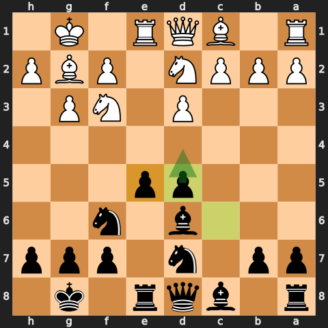
  
<strong>Quiet d3: take the centre when allowed.</strong> After 9...Nbd7: Black has e5 and d5, developed the kingside and castled. ...Re8 supports the centre before further expansion.

Game 102 is a clear example; game 119 adds maneuvering play. Remember that the b8-knight cannot go to c6 while the pawn occupies c6, so `…Nbd7` is natural. Develop, defend the centre, and advance `…d4` or `…e4` only when it gains space without shedding a pawn. [Game 102](https://www.youtube.com/watch?v=mKmkrye5lUs&t=910s), [game 119](https://www.youtube.com/watch?v=FmT5SkOnEHE&t=820s).

A queen exchange after `…dxe4 dxe4 Qxd1+ Kxd1` is another option in the right d3 move order, as in game 9. Eric himself notes that White losing castling rights is not automatically a major problem once queens are off. [Explanation.](https://www.youtube.com/watch?v=YDUfNGkU3GA&t=20s)

## 10. Against other first moves: the Slav boundary

Against `1.d4`, Eric still starts with `…c6` and `…d5`. If White plays c4, this is Slav territory. The c4-pawn puts pressure on d5, which changes when Black can safely release the c8-bishop.

Game 103 uses a Semi-Slav setup with `…e6` before bishop development, then `…dxc4`, `…b5`, and `…Bb7` when the position supports it.

  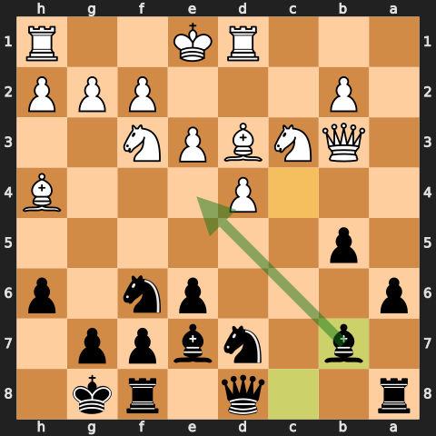
  
<strong>Against d4 and c4: a separate Slav branch.</strong> After 13...Bb7: ...dxc4 and ...b5 allowed the bishop to develop actively. This is a Semi-Slav structure, not a Caro-Kann.

The warning is game 99:

`1.d4 c6 2.c4 d5 3.Nc3 Nf6 4.e3 Bg4 5.f3 Bh5 6.cxd5 cxd5 7.Qb3`

  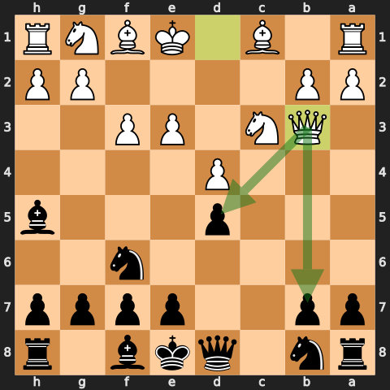
  
<strong>Slav: an early bishop can expose b7.</strong> After 7.Qb3: the queen attacks b7 and d5. Early ...Bg4 has created a concrete defensive problem.

Qb3 attacks b7 and d5. In the game `7…e6 8.Qxb7` costs a pawn. Eric acknowledges that this is exactly the danger of developing the bishop too early. [Explanation.](https://www.youtube.com/watch?v=mKmkrye5lUs&t=20s) The study includes `4…e6` as an engine-checked alternative.

Against quieter London, Colle, fianchetto, b3, and b4 setups, he often has time for an outside bishop and a compact `c6-d5-e6` triangle. If White challenges the centre, re-evaluate immediately.

Some games add `…f5` and become Stonewalls. In games 43–45 and 69 the bishop is already outside the chain; in other Stonewall games it is not. That difference matters. `…f5` is an optional structural commitment, weakening e5 and the king's surroundings as well as gaining control of e4. It is not a routine Caro-Kann developing move. [Eric's explanation of the transition.](https://www.youtube.com/watch?v=-Gp7ZDRtDKo&t=3350s)

## 11. Recaptures, pawn breaks, and the middlegame

Ask what the recapture **makes possible**, not merely whether it doubles a pawn.

| Recapture | Benefit to look for | Cost or check |
| --- | --- | --- |
| `…cxd5` in the Exchange | Keeps a central pawn, clears c6, opens the c-file | White has the e-file and may gain activity. |
| `…bxc6` after a bishop/knight exchange | Supports d5, opens the b-file, sometimes enables …Ba6 | Doubled pawns can become targets; the king may still need protection. |
| `…hxg6` after a bishop trade | Opens the h-file and preserves a central pawn | The extra g-pawn is not a free attack; inspect king shelter and rook access. |
| `…exf5` | Opens the e-file and adds control of e4 | Doubled f-pawns can be weak; the centre has changed. |
| `…gxf5` in the Exchange fianchetto | Opens the g-file and controls e4 | The castled king has less pawn shelter. |
| `…exd5` in a Slav structure | Opens the e-file; can free the c8-bishop | Do not import a …cxd5 plan without checking the new files and pawn majorities. |

The common breaks are `…c5` against d4, and `…e5` when Black can safely occupy or challenge the centre. `…f6` can challenge an advanced e5-pawn, but it is much more sensitive to king safety and piece coordination. It is a calculation, not a fallback pawn move.

**If White's centre is fixed, improve your worst piece.** A knight may have a useful route through a5 to c4, or through e7 to f5. A bishop may gain a new diagonal after a pawn exchange. A rook belongs on an available file, not on a memorized square.

**If you win a pawn, secure it with development.** Eric often offers queen exchanges once ahead. That reduces mating danger, but only if the resulting ending is actually favorable. Before trading, check pawn weaknesses, activity, king access, and whether your extra pawn is useful. Keep enough pieces to defend your remaining weaknesses.

**If you are cramped, exchanges may help.** Game 120 illustrates the idea particularly clearly: White's space matters less after several attacking pieces disappear. The late loss is also a reminder that reaching a good position is only the beginning of conversion.

## 12. Tactics worth learning, and a sacrifice not to copy

### Loose central pawns

A bishop pin on f3 can remove an apparent defender of d4 or e4. But check whether the knight is genuinely unable to move, whether a queen exchange changes the pin, and whether grabbing the pawn exposes your own king. Game 77 shows `…Bxe2 Qxe2 Nxd4`; game 71 shows another early d4-pawn grab.

The useful habit is **count after the exchange**, not “Caro-Kann players may always take pawns.”

### A bishop attacked on f5 may not need to move

In game 58:

`1.e4 c6 2.d4 d5 3.e5 Bf5 4.Nf3 e6 5.Nh4?`

  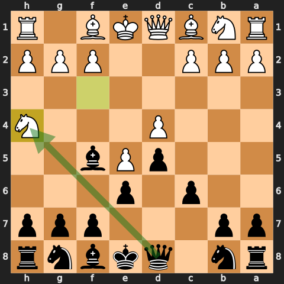
  
<strong>Advance: the queen sees h4 too.</strong> After 5.Nh4: e7 is empty, so Qd8 can take the undefended knight on h4. Bishop attacks do not override loose pieces.

The knight is loose on the d8-h4 diagonal. `5…Qxh4` wins it. The game continues `6.g3 Qe4+ 7.Be2 Qxh1+`, winning the rook as well. White could choose a more stubborn sixth move, so do not claim the rook falls by force after every defense. [Eric's explanation.](https://www.youtube.com/watch?v=HI0Q1obUbXA&t=3740s)

### The Greek gift: check the forward king move

Game 20 is attractive and dangerous to learn from casually. Eric plays `14…Bxh2+ 15.Kxh2 Ng4+`, and wins after White retreats with `16.Kg1`.

  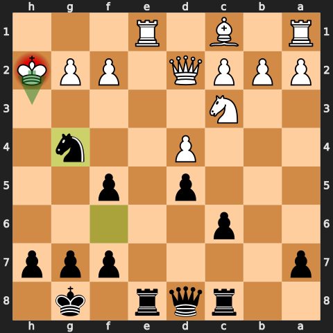
  
<strong>A successful attack is not necessarily a sound sacrifice.</strong> After 15...Ng4+: White should consider 16.Kh3, not only retreat. The game's 16.Kg1 allowed the attack to flourish.

**Engine correction: White should consider `16.Kh3!`.** Stockfish's deeper check favors White. One illustrative defense is `16…Qd6 17.g3 Qg6 18.Rxe8+ Rxe8 19.Qg5`. The full details and search limits are in the validation report.

The video's later mate does not make the original sacrifice sound. Before sacrificing, check king moves toward the attacking pieces as carefully as retreats. Also check queen trades, intervening checks, and whether another piece can join without losing a tempo. [The game's attacking explanation begins here.](https://www.youtube.com/watch?v=YDUfNGkU3GA&t=3473s)

## 13. A practical study route

The game numbers below refer to the unchanged 148-game collection, not video chapter numbers.

| Stage | Games | What to explain before moving |
| --- | --- | --- |
| Learn the framework | 1, 12, 29, 104 | Why this bishop square? Why this knight route? What pawn break is next? |
| Learn the exceptions | 20, 23, 55, 99 | Which pin, bishop retreat, or queen threat makes the routine move wrong? |
| Learn the alternative structures | 75, 90, 97, 128, 136 | Which file opened? What did the pawn recapture gain and concede? |
| Study resistance | 64, 117, 120 | Was the opening actually bad, or did the result turn later? |
| Extend beyond 1.e4 | 43, 69, 103, 139 | Is this a Slav or Stonewall? Does bishop-out-first still apply? |

Use the **22-chapter study PGN** for the first pass. It contains short source excerpts, explanatory comments, and labelled corrections. Use the **complete game PGN** to see how the plans succeed or fail after the opening.

For each study position:

1. Hide the next move and name White's threat.
2. Choose a move and explain which piece, square, or pawn it improves.
3. Check the forcing reply that would embarrass your choice.
4. Compare the played move, the guide's explanation, and any engine correction.
5. Replay from the other side and try to make White's plan work.

Three useful calculation tests are diagram 10 (`…Qb6`), diagram 21 (`Kh3`), and diagram 22 (`…Qxh4`). They test different habits: an intermediate move, a defensive king advance, and a loose piece hidden behind an apparent threat.

## 14. Your between-moves checklist

- **Identify the structure:** Advance, Exchange, main-line Caro-Kann, Panov, or something else?
- **Check the threat:** checks, captures, pins, and attacks on the bishop come before the setup.
- **Give the knight a square:** is c6 occupied? Is f6 controlled by e5? Does e7 block the bishop?
- **Count before taking:** include the opponent's forcing reply and your king's safety.
- **Challenge the centre:** prepare …c5 or …e5 when the pieces support it.
- **Use the resulting file:** c-, e-, h-, or g-file according to the actual recapture.
- **Reassess after exchanges:** the same move can be excellent in one structure and pointless in the next.

Eric's recurring practical achievement is getting a sturdy, playable position with understandable plans. The engine checks preserve that approach while separating it from tactical shortcuts that worked only because the opponent cooperated.
