# The London System, as Aman Hambleton Plays It

A practical guide to Aman's London speedrun: develop the f4-bishop, choose the right centre, keep the pieces coordinated, and attack only when the position supports it. The useful lesson is how he changes the setup when Black changes the problem.

[Original 18-part series](https://www.youtube.com/playlist?list=PLUjxDD7HNNTiljFCufDXDSjEQH1cIdbSx) · [130 recovered games](../pgn/london-system-games.pgn) · [22 annotated study chapters](../pgn/london-system-repertoire.pgn) · [Sources and complete game index](../sources/london-system.md) · [Stockfish findings](../sources/london-system-validation.md)

**Corpus and scope.** The games were recovered directly from Chess.com's public archives. Aman used **systemplayer** in the videos; the historical account is now **systematic**. This collection contains the 130 five-minute games with White from the matched first game on June 30, 2022 through the finale game on August 18. It excludes 23 earlier games before the rating reset, an intervening bullet session, Black's games and later activity. The archive records 2498 after the last game. Full provenance, episode windows and the limits of video matching are in the source index.

The guide draws on selected teaching passages across all 18 recovered caption tracks, PGN replay and Stockfish 18 analysis. It is an editorial synthesis. In-guide video links locate teaching passages. Both PGNs also embed verified game/review-point links with explicit precision labels; those timestamps are not exact game starts. All 22 boards are actual game positions, shown from White's side. Arrows show candidate moves, pressure or plans, sometimes requiring preparation. A board depicting a mistake is a warning. Study chapters end at `*` because they are excerpts; the complete game scores retain their actual results.

## Guide map

- **First decisions:** [the opening tree](#1-the-first-decision-is-blacks-centre), [piece placement and move order](#2-the-pieces-have-jobs-and-the-order-matters).
- **Main structures:** [c3](#3-c3-hold-d4-and-prepare-a-central-break), [c4](#4-c4-challenge-black-instead-of-building-a-smaller-centre), [early queen pressure](#5-qb6-identify-which-position-you-actually-have), [recaptures](#6-a-recapture-is-a-structural-decision).
- **Making it work:** [the bishop](#7-preserve-the-bishop-when-it-is-worth-preserving), [e4 and e5](#8-pawn-breaks-turn-development-into-play), [fianchettos](#9-d5-and-g6-nc3-and-a-different-kingside-plan), [d6 and g6](#10-d6-and-g6-the-e4-centre-and-queenside-castling), [coordination](#11-choose-the-queen-and-rook-squares-for-the-position), [sacrifices](#12-two-sacrifices-with-different-lessons).
- **Practice:** [non-London boundaries](#13-two-first-moves-that-change-the-repertoire), [study route](#14-a-practical-study-route), [checklist](#15-your-between-moves-checklist).

## 1. The first decision is Black's centre

Begin with `1.d4`, then usually `2.Bf4`. The bishop develops before e3 closes its diagonal. **Look at Black's first move before committing to Bf4.** Aman explicitly warns against premoving it in the [Part 4 review](https://www.youtube.com/watch?v=rwsumP3aq_I&t=3299s).

| Black's approach | Aman's recurring response | What you are trying to achieve |
| --- | --- | --- |
| `…d5`, `…e6`, then `…c5` | `e3`, `c3`, `Nd2`, `Ngf3`, often `Bd3` | Maintain d4, develop the queenside promptly, prepare e4 or Ne5. |
| Early `…Bf5` | Usually `c4`, `Nc3`, often `Qb3` | Challenge d5 and the b7-pawn the bishop no longer defends. |
| Early `…Nc6` in a d5 structure | Usually `c4` and `Nc3` | Use the time before Black can play an effective …c5. |
| Quiet moves with no immediate central pressure | Consider `c4`, `Nc3` | Gain useful space rather than automatically restrict yourself with c3. |
| `…d6`, with the e-pawn ready to advance | Early `h3`, often `Bh2`, usually `Be2` | Avoid developing both bishops into an …e5-e4 tempo sequence. |
| `…d5` and `…g6` | Later episodes favor `Nc3`, `e3`, `h4` | Play actively against the fianchetto without assuming e4 is immediately available. |
| `…d6` and `…g6` | `Nc3`, often `e4`, `Qd2`, queenside castling | Occupy the centre and develop an active plan with appropriate king safety. |
| Early `…Qb6` | A concrete defense, counterattack or gambit | Check b2, d4, …c4 and …Nh5 before following a standard sequence. |
| `1…e5` | `2.dxe5`, then simple development | Leave the usual London and avoid defending the extra pawn at any cost. |
| `1…c5` | Usually `2.d5` | Take central space and enter a Benoni-type game. |

These are the teacher's practical defaults, not universal opening laws. In particular, “c3 against …c5” describes the main setup; it does not prohibit every later c4 break. The centre, development and tactical details can change.

## 2. The pieces have jobs, and the order matters

| Piece or pawn | Usual job | Reason to choose differently |
| --- | --- | --- |
| c1-bishop | Develop to f4 before e3; retreat to g3 or h2 | An exchange may improve a knight, open a file or remove an important defender. |
| b1-knight | d2 behind a c3-pawn; c3 after c4 or in an active fianchetto line | Do not obstruct the pawn break your position needs. |
| g1-knight | f3, often toward e5 | Delaying Nf3 keeps the queen's diagonal to h5 open. |
| f1-bishop | d3 against a stable d5 centre | Be2 is often better when …e5-e4 would attack Bd3 with tempo. |
| c-pawn | c3 for reinforcement; c4 for pressure and space | Preserve flexibility when Black has not committed its centre. |
| h-pawn | h3 provides h2 for the bishop | h4 belongs to a different, more aggressive plan; check the consequences. |
| Queen | b3 for queenside pressure; e2, f3 or b1 for coordination | A queen on c2 can be exposed on the c-file; an early queen sortie may cost time. |
| Rooks | Use an open or half-open file; lift a rook when the centre is stable | An attacking rook can leave a real weakness behind. |

The move order `Nd2` before `Ngf3` is particularly useful in the c3 setup. The queen on d1 still sees h5 along d1-e2-f3-g4-h5. An unprepared `…Nh5` may therefore lose the knight. [Aman explains this development order in Part 11.](https://www.youtube.com/watch?v=vyxK0vqxowo&t=29s)

  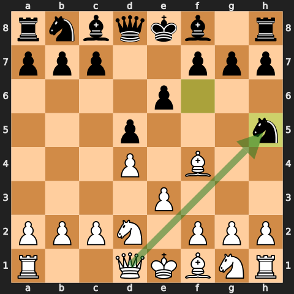
  
<strong>Why Nd2 often precedes Nf3.</strong> After 4...Nh5?: the queen still sees h5 because the g1-knight has not gone to f3. Qxh5 wins the knight.

Game 60 gives the direct example:

`1.d4 d5 2.Bf4 Nf6 3.e3 e6 4.Nd2 Nh5? 5.Qxh5`

This does **not** mean that …Nh5 is always a blunder. If Nf3 has blocked the queen's diagonal, e2 is occupied, the knight arrives from another square, or a tactical detail changes the line, recalculate. A theme is useful only when you can see why it works.

## 3. c3: hold d4 and prepare a central break

When Black plays …c5 against d4, Aman usually reinforces with c3 and brings the queenside pieces into play promptly. The b1-knight goes to d2; the g1-knight follows to f3. Black's pressure on b2 or d4 can become awkward if White spends every tempo on the other wing. [Part 5 explains the development priority.](https://www.youtube.com/watch?v=0hlDcA0Zc9M&t=72s)

  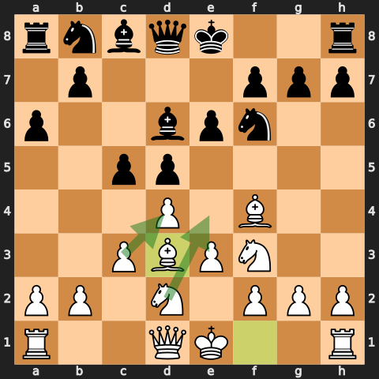
  
<strong>The c3 and Nd2 setup.</strong> After 7.Bd3: c3 holds d4 and both knights are developed. The arrows show support for d4 and e4, not a recommendation to play Ne4 into the d5-pawn.

Game 25 begins:

`1.d4 d5 2.Bf4 e6 3.e3 c5 4.c3 a6 5.Nd2 Nf6 6.Ngf3 Bd6 7.Bd3`

White has a coherent position, but Black has options. An exchange on d6, Ne5, e4 and castling are candidates; none is compulsory in every order. In the game Black pushes `…c4`, gaining queenside space but releasing the immediate pressure on d4. White retreats the bishop, exchanges on d6 and plays e4.

The c3-pawn is not the purpose of the opening. Its purpose is to make development and central play easier. Once the centre changes, the knight may reroute and the c-pawn may advance again.

After `…cxd4`, **exd4 is often the natural recapture**: the c3-pawn keeps supporting d4 and the e-file becomes half-open for White while Black retains an e-pawn. This is one of Aman's recurring preferences in the [Part 16 discussion](https://www.youtube.com/watch?v=klPQ8hPGCnU&t=1406s). Verify the actual threats before treating a preference as a rule.

Game 11 reaches that structure from a fianchetto setup: `9…cxd4 10.exd4`, followed by Re1. The half-open e-file matters because Black is preparing …e5; Black still has a pawn on that file. A rook belongs on a file for a reason, not merely because the square looks standard.

## 4. c4: challenge Black instead of building a smaller centre

Aman repeatedly chooses c4 when Black develops the light-squared bishop early, blocks the c-pawn with …Nc6, or spends time on moves that do not challenge the centre. The knight then usually develops to c3. [The Part 3 explanation makes the connection explicit.](https://www.youtube.com/watch?v=OidsHHg6Nm0&t=1242s)

### A. Against an early …Bf5

Black's bishop has left b7 behind. c4 challenges d5; Nc3 reinforces the pressure and supports e4; Qb3 may attack b7 and d5 together.

  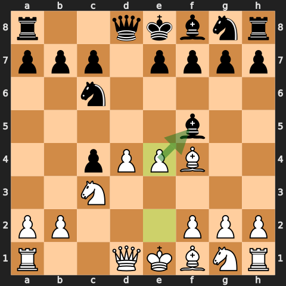
  
<strong>Challenge an early ...Bf5.</strong> After 5.e4: ...dxc4 let White take central space while attacking the bishop on f5. Recover c4 and develop.

Game 2 shows what can happen when Black takes on c4 without enough development:

`1.d4 d5 2.Bf4 Bf5 3.c4 dxc4 4.Nc3 Nc6 5.e4`

White attacks the bishop and gains central space, but Black can counter with **5…Qxd4** rather than retreat immediately. The checked response is **6.Qc2**, keeping active play before recovering material. The next tasks are development and king safety; e4 does not force a material gain. This is a concrete pawn investment, not permission to play e4 whenever you like.

The opponent can defend more carefully. In game 58, after `1.d4 Nf6 2.Bf4 d5 3.e3 Bf5 4.c4 c6 5.Nc3 e6 6.Qb3`, Black plays `6…Qc8`. Aman develops with Rc1 and Nf3 rather than inventing a forced attack. [He discusses this defense in Part 6.](https://www.youtube.com/watch?v=PqFwbmSvm38&t=385s)

  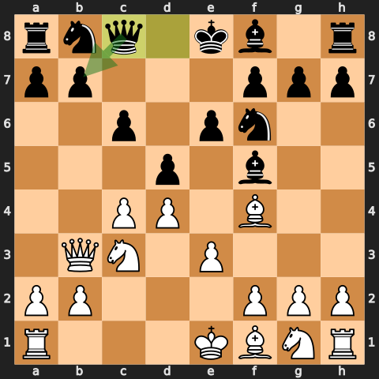
  
<strong>Respect ...Qc8 as a defense.</strong> After 6...Qc8: b7 is defended without offering the queens an immediate b-file confrontation. Develop; there is no automatic tactic.

### B. Against …Nc6 before …c5

A knight on c6 blocks the c-pawn. White often has time to play c4 and develop the other knight actively. If Black later wants …c5, the knight must move or a structural change must make the advance possible.

Game 14 follows `1.d4 d5 2.Bf4 Nc6 3.e3 Nf6 4.c4 dxc4 5.Bxc4 e6 6.Nc3 Bd6 7.Bg3 Bxg3 8.hxg3`.

  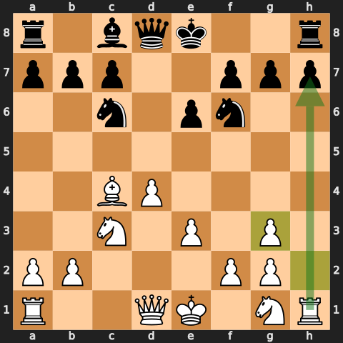
  
<strong>An early ...Nc6 and a half-open h-file.</strong> After 8.hxg3: White has a half-open h-file, with Black’s h7-pawn still on it. The doubled g-pawns are a cost; keeping e3 preserves support for d4.

White has a half-open h-file and sensible development; Black’s h7-pawn remains a potential target. That is compensation for exchanging the bishop, not a guaranteed attack. Black can castle, pressure the centre and contest files. The follow-up must involve the rest of White's army.

### C. Against a quiet …d6 setup

When Black does not contest d4 promptly, c4 gives more space and supports an active Nc3. In game 7, Aman uses h3, c4, Nc3 and Be2. The bishop choice anticipates a future …e5-e4 advance. [His explanation starts near the beginning of Part 2.](https://www.youtube.com/watch?v=pkOkSGuQvh8&t=51s)

  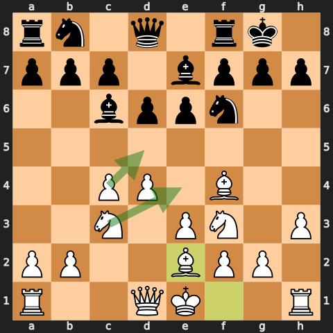
  
<strong>Quiet black centre: take more space.</strong> After 8.Be2: c4 and Nc3 use the space Black has conceded. Be2 avoids an ...e5-e4 tempo against Bd3.

A useful question is: **what would c3 be protecting right now, and what would c4 let my pieces do?** If the answer to the first is “nothing urgent,” you may be able to take more space.

## 5. …Qb6: identify which position you actually have

There are several different queen-pressure problems in this series. Do not combine them into one memorized trick.

### A. c3 has already been played: Qb3 and the half-open a-file

In game 22, `1.d4 d5 2.Bf4 c5 3.e3 Nc6 4.c3 Qb6 5.Qb3` answers pressure with pressure. The game continues `5…Nf6 6.Nd2 Bf5 7.dxc5 Qxb3 8.axb3`.

  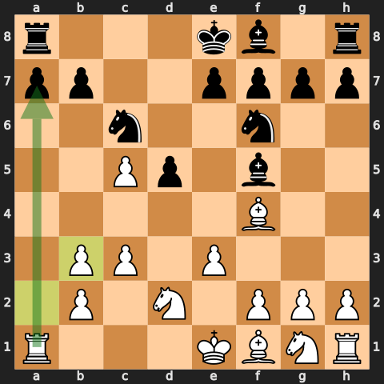
  
<strong>Let Black make the queen exchange.</strong> After 8.axb3: doubled b-pawns come with a half-open a-file; Black’s a7-pawn remains. Compare activity with structure before condemning the recapture.

White accepts doubled b-pawns because the a-file becomes half-open for White and the queens are gone; Black’s a7-pawn remains on the file. In this exact position, capturing on c5 first also changes the material and central tension. White still needs development; the structural imbalance does not win by itself.

Game 34 gives a more ambitious follow-up after a similar queen exchange: b4 supports the advanced c5-pawn and prepares more queenside space.

  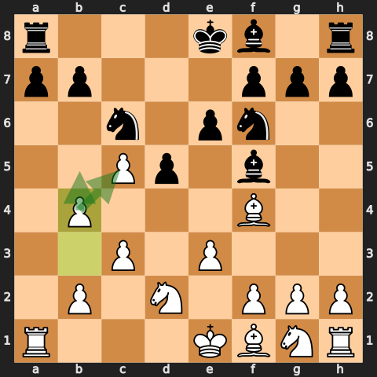
  
<strong>Use b4 after the queen exchange.</strong> After 9.b4: the b-pawn supports the advanced c5-pawn and threatens to gain more queenside space. Black can still counter in the centre.

Learn what the recapture gives you. Do not conclude that doubled b-pawns are always desirable or that the queens should never be exchanged by White. The best move can change with one pawn or knight placement.

### B. A sharp symmetric exception: Nb5 is not automatic

Game 31 is a warning against learning only from the result:

`1.d4 d5 2.Bf4 Bf5 3.c4 e6 4.Nc3 Nf6 5.e3 c5 6.Qb3 Qb6 7.cxd5 exd5 8.Nb5?`

White eventually won, but **8…c4!** is a strong reply. It attacks Qb3 while the knight's apparent threat on d6 creates a tactical distraction. One checked illustration is `9.Nd6+ Qxd6 10.Bxd6 cxb3 11.Bxf8 Rxf8 12.axb3`; Black has won a piece for a pawn. This is editorial analysis, not the played line.

Stockfish prefers `8.Qxb6` in the position before Nb5. The deeper check after Nb5 strongly favors Black. The game's `8…Na6` also allowed Black good play; the subsequent win does not establish the knight jump's soundness. See the [validation report](../sources/london-system-validation.md) for search settings and scores.

### C. …Qb6 before c3: the bishop and b2 can both become problems

Game 19 reaches `1.d4 Nf6 2.Bf4 c6 3.e3 Qb6`. Aman plays Qc1, but `…Nh5` then forces a decision about the bishop. In the game he exchanges it for the b8-knight.

  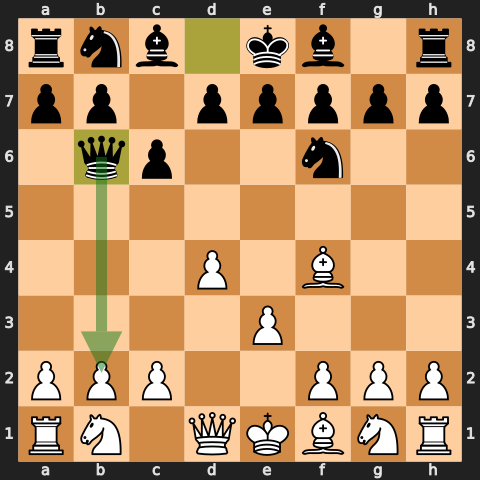
  
<strong>An early ...Qb6 changes the priorities.</strong> After 3...Qb6: b2 is attacked before White has played c3. Qc1 is the played defense, but ...Nh5 then forces a bishop decision.

The point is not “always defend b2 with Qc1.” The queen defense may leave a concession elsewhere. Aman explicitly reviews this awkward move order in [Part 4](https://www.youtube.com/watch?v=rwsumP3aq_I&t=985s). When Black pressures b2 early, check whether your normal development plan still protects the bishop and the centre.

### D. The …Qxb2 gambit: concrete play and a result that cuts both ways

Games 112 and 123 share:

`1.d4 Nf6 2.Bf4 c5 3.e3 Qb6 4.Nc3 Qxb2 5.Nb5 Nd5 6.Rb1 Qxa2 7.Ra1 Qb2 8.Rb1`

  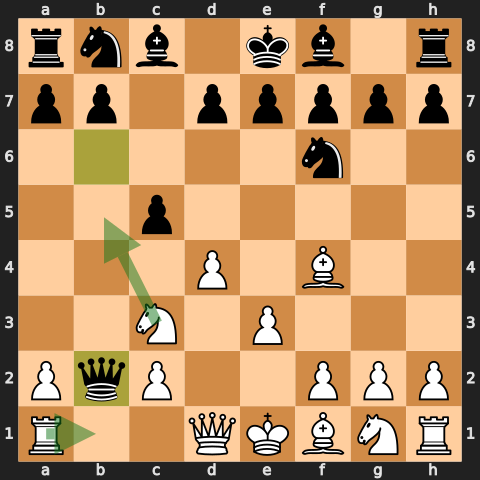
  
<strong>The sharp ...Qxb2 line.</strong> After 4...Qxb2: White plays Nb5 and Rb1 to gain time against the queen. This is a concrete gambit, not a free attack.

White gains tempi against the queen and threatens jumps with the knight. This is a gambit. White has given up real pawns, and Black's best defense matters. In game 112 Black blunders `8…Qc3+?`, allowing Nxc3 and a winning material imbalance. That is an example of punishing a mistake, not a refutation of …Qxb2.

In game 123 Black instead plays `8…Qa2`. Aman chooses c4 and eventually loses. The engine prefers **9.Ra1**, retaining the queen-chase possibility, to the game's immediate **9.c4**. At the tested search limits c4 gives Black the better game; a strong answer is `9…Qa5+`, while the game's `9…Nxf4` still allows White to return to a repetition idea with Ra1.

  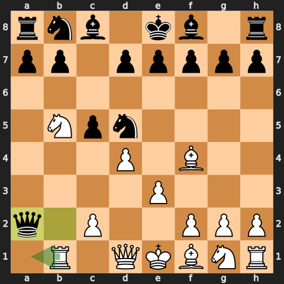
  
<strong>The same gambit against stronger defense.</strong> After 8...Qa2: Ra1 keeps the queen-chase resource, while the played c4 gives Black a stronger reply. Ra1 does not force Black to repeat.

The [finale discussion](https://www.youtube.com/watch?v=Zkcyyj9xTT8&t=670s) acknowledges the repetition motif. For example, `9.Ra1 Qb2 10.Rb1 Qa2` reaches a third occurrence of the position after 6…Qxa2 when the complete game history is counted. Black can deviate, so this resource is **not a forced draw**. Repeating a position is a legitimate outcome. If you want a lower-maintenance repertoire, study the concrete defense of b2 rather than adopting a pawn gambit from its most spectacular win.

## 6. A recapture is a structural decision

Aman changes his advice when the c-pawn changes square. This is one of the most transferable lessons in the series. [Part 7 contrasts the structures.](https://www.youtube.com/watch?v=-guvn4tkgmU&t=46s)

| Exchange | What the recapture can give White | What to check |
| --- | --- | --- |
| `…Bxf4 exf4` with c3 and d4 intact | The c3/d4/f4 pawns control important central squares; e5 becomes a useful outpost. | The e-file becomes half-open for White if Black retains an e-pawn; e3 is vacated, and f4 may become a target. |
| `…Bxf4 exf4` after c4 | Central activity and a half-open e-file may still matter. | If the c-pawn has been exchanged, moving e3 to f4 can leave the d4-pawn isolated. The doubled f-pawns may also become targets. |
| `…Bxg3 hxg3` | A half-open h-file while Black retains an h-pawn, plus a pawn on g3 that controls f4/h4. | The often-doubled g-pawns, king placement and whether the rook can use the file; retaining e3 can help support d4. |
| `…cxd4 exd4` | c3 continues to support d4; the e-file becomes half-open for White if Black retains an e-pawn. | Tactics on e3/e4, a backward pawn, or a piece on the file can change the choice. |
| `…cxd4 cxd4` | Both c-pawns have left their file, opening the c-file and changing the centre. | You have removed c3's support and altered the knight's routes; compare the resulting position. |

For a concrete comparison, in game 14’s position after 6…Bd6, the illustrative line `7.Nf3 Bxf4 8.exf4` leaves d4 isolated: White’s c-pawn has gone and the e-pawn has moved to f4. The game’s Bg3 and hxg3 keep the e3-pawn supporting d4, at the cost of doubled g-pawns.

A rule such as “double the f-pawns” has no value without its condition. Count the central pawns that will remain after the next exchanges. Then decide which piece or file improves.

## 7. Preserve the bishop when it is worth preserving

An early h3 often provides a simple retreat to h2. Against …d6 setups, Aman frequently makes the shelter before Black can gain a tempo with …e5. In game 11 the bishop reaches h2 before the central confrontation.

  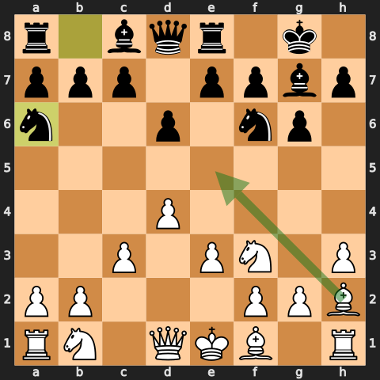
  
<strong>Prepare a home for the bishop.</strong> After 7...Na6: White has already used h3 and Bh2 to shelter the bishop before Black can advance ...e5 with tempo.

The alternative Bg3 can also work, particularly when …Bxg3 would open the h-file. A bishop on e5 may exploit the queen's continuing control of h5, but it can also be challenged by …f6 or a knight. Calculate the retreat squares rather than treating any one as invulnerable.

Aman's preference for keeping the London bishop is practical: it can remain active on the h2-b8 diagonal and support attacks. It is not an obligation. If an exchange gives you useful central control, removes a key defender or develops another piece, compare it honestly.

  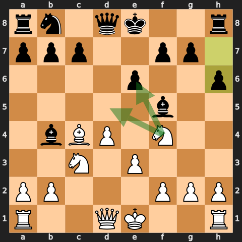
  
<strong>Let the bishop go when a piece improves.</strong> After 9...h6: the exchange on f4 has improved White's remaining knight. There is no duty to preserve the London bishop at any cost.

In the finale game, `7…Nd5 8.Ne2 Nxf4 9.Nxf4` trades the bishop for a central knight and improves White's other knight. The rest of the game becomes an active positional struggle. The opening's name does not require the original bishop to survive.

## 8. Pawn breaks turn development into play

### e4: challenge Black's centre

The common preparation is Nd2, Bd3 and sometimes Qe2 or Re1. Count attacks on e4 and calculate …dxe4 before pushing. If Black has advanced …c4, d4 is no longer under attack from the c-pawn; White may have more freedom to challenge d5 with e4.

  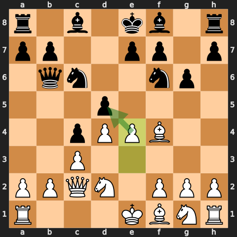
  
<strong>Answer ...c4 by looking at e4.</strong> After 8.e4: Black pushed past d4 with ...c4; White uses the time and Nd2 support to challenge the centre.

Game 129 gives a clear example: `1.d4 Nf6 2.Bf4 d5 3.e3 c5 4.c3 Nc6 5.Nd2 Qb6 6.Qb3 c4 7.Qc2 g6 8.e4`. The queen steps out of the c-pawn's attack and supports the central break. Black's queenside space does not mean White must sit still.

Do not play e4 just because a book diagram shows it. If it leaves d4 loose, opens the king or allows a tactical capture, first improve the position. Aman's occasional premature or inaccurate breaks remain part of the record; the engine audit does not conceal them.

### Ne5 and f4: establish a central piece, then support it

A knight on e5 can obstruct Black, threaten checks and make a rook lift possible. f4 can support that knight and increase attacking space. It also weakens squares around the king and commits another pawn. Check whether …f6 can drive the knight away and whether you can meet a central break.

The [Part 17 main-line explanation](https://www.youtube.com/watch?v=qm5t3xAdJMk&t=115s) develops these ideas together. The sequence is useful because the pieces cooperate, not because f4 carries a built-in attack.

### e5: restrict the defender or gain a tempo

Once White has an e4-centre, e5 can attack Nf6 and clear lines for the bishops. It may also leave d5 or d4 weak. Calculate captures and the next knight square. Against a well-developed opponent, a premature advance can hand over the central squares you meant to control.

## 9. …d5 and …g6: Nc3 and a different kingside plan

The early episodes often use a quiet e3/c3 setup against a fianchetto. Later Aman introduces a more active choice with Nc3 and h4. He explicitly recommends the knight placement against the combined …d5/…g6 structure in [Part 10](https://www.youtube.com/watch?v=NtcXbhKBWwI&t=403s).

  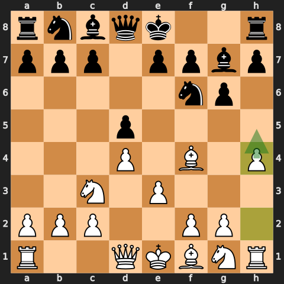
  
<strong>Against ...d5 and ...g6: Nc3 and h4.</strong> After 5.h4: White supports a kingside expansion. If Black stops h5 with ...h5, change plans rather than push automatically.

Game 59 starts `1.d4 d5 2.Bf4 Nf6 3.e3 g6 4.Nc3 Bg7 5.h4`. White can threaten h5, gain space or use the resulting pawn contact. Black's `…h5` stops that immediate advance; White must find another useful plan.

Typical next questions are whether Ne5 is available, whether g4 is justified, and where the king belongs. Nc3 can also support an eventual e4 break. But the d5-pawn means you cannot assume that White gets a large centre for free.

The bishop on g7 is a real defender and a real source of counterplay. Before opening files, inspect the long diagonal and the centre. Opposite-side castling makes both players' pawn advances more urgent; it does not make White's attack automatically faster.

## 10. …d6 and …g6: the e4 centre and queenside castling

Without a black pawn on d5, Nc3 can support e4 directly. Aman develops this more ambitious branch as the series progresses. In game 63:

`1.d4 d6 2.Bf4 g6 3.Nc3 Bg7 4.e4 Nf6 5.Qd2`

  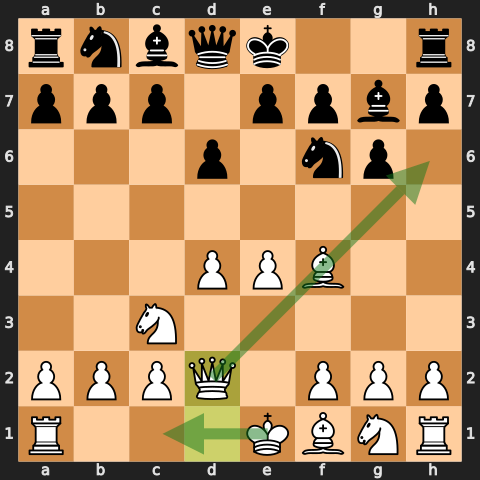
  
<strong>Against ...d6 and ...g6: build the e4 centre.</strong> After 5.Qd2: Nc3 supports e4, while Qd2 prepares queenside castling and can back a later Bh6. Check Black’s central breaks and queenside counterplay first.

Qd2 clears d1 for queenside castling and can support a later Bh6. Bh6 may exchange the fianchettoed bishop; f3 may reinforce e4; h4 can start an attack. The choices depend on Black's centre and development. If Black plays …c5 or …e5, answer that problem before moving every pawn toward the king.

This is a different structure from the quiet e3/c3 London: White has pawns on e4 and d4 with the dark-squared bishop already on f4. Answer Black’s central breaks and develop around that centre; do not return automatically to the c3/Nd2 setup.

### A loss worth studying

Game 114 against Victzzz begins with the same active knight development, but Black plays …c5, exchanges on d4 and then prepares …e5. After `10.Be3 e5 11.dxe5 dxe5 12.Bc4 Nd4`, Black has active central play.

  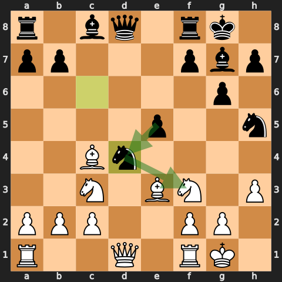
  
<strong>Fianchetto warning: do not surrender the centre.</strong> After 12...Nd4: Bxd4 exd4 creates a protected d4-pawn, not a passed pawn: White’s c2-pawn remains on an adjacent file. A c3 challenge requires moving the c3-knight first.

The game's `13.Bxd4 exd4` gives Black an advanced, protected d4-pawn. It is **not a passed pawn**: White’s c2-pawn remains ahead of it on an adjacent file. A c3 challenge requires moving the c3-knight first; the timing matters because Black can advance to d3. It is **not** an immediate losing blunder in the deeper engine comparison; White can defend. The eventual checkmate comes after further mistakes. Study how Black uses the centre and the dark squares, rather than attributing the loss to one bishop exchange or to Nc3 itself.

A useful alternative at the displayed position is Bd5, keeping central control. That is an engine-checked editorial candidate, not an assertion that Aman recommended it in the video.

## 11. Choose the queen and rook squares for the position

Qb3 is a pressure move; Qe2 connects pieces and supports e4; Qf3 can support the centre and reach h3; **Qb1** keeps the queen off the c-file and backs the Bd3 diagonal. If the bishop captures on e4 the queen can support it; direct queen pressure toward h7 requires the bishop to clear the line. A queen retreat can improve coordination.

  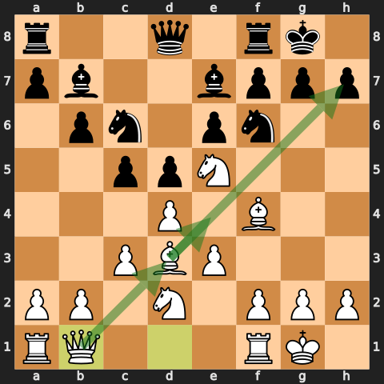
  
<strong>Qb1 keeps the queen off the c-file.</strong> After 10.Qb1: the queen backs the Bd3 diagonal and stays off the c-file. Bxe4 can be supported by the queen; direct queen pressure toward h7 requires the bishop to clear the line.

Game 109 reaches Qb1 in a normal developed London. In the [Part 16 explanation](https://www.youtube.com/watch?v=klPQ8hPGCnU&t=1406s), Aman contrasts it with the more exposed Qc2 and also notes the possibility of b4. These are plans, not threats that must immediately win material.

Rook lifts such as Rf3-h3 are powerful when the centre is stable, the knight on e5 is secure and Black's pieces cannot attack the rook with gain of time. Before lifting, ask what you have stopped defending. A rook that joins an attack also leaves its old file.

An attack can succeed without mate. Extra pawns, a better ending or a weak opposing king can justify exchanging queens. Aman explicitly discusses an attack that produced three pawns and required a longer conversion in [Part 13](https://www.youtube.com/watch?v=izNk3Dd4zZA&t=1870s). Learn to recognize the gain you have earned and change tasks when the attack has done its work.

## 12. Two sacrifices with different lessons

### A. A Greek-gift win that was not forced

Game 39 reaches the familiar-looking Bxh7+ idea after Black castles. White has Bd3, Nf3 and a queen ready to join the attack.

  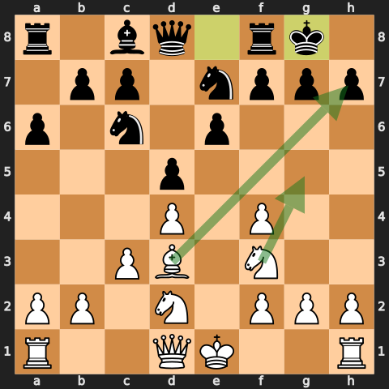
  
<strong>Calculate before the Greek gift.</strong> After 8...O-O: Bxh7+ is a candidate because Ng5+ and Qh5 can follow. Calculate both acceptance and refusal, not just the game result.

Aman plays `9.Bxh7+ Kxh7 10.Ng5+ Kh8`, and Black resigns. White then has the forced mate `11.Qh5+ Kg8 12.Qh7#`. **10…Kg6!** is a checked defense, and the stronger search also finds **10…Kh6**. These forward king moves lead to roughly balanced play rather than a forced win for White. One illustrative continuation is `11.Qc2+ f5 12.O-O-O Qd6 13.Ndf3`; this requires further play and is not a forced mating sequence.

The deeper unrestricted search before the sacrifice prefers Qe2, keeping a useful advantage. The sacrifice gives up much of that advantage against accurate defense. The lesson is to calculate the king's **forward** escape as carefully as its retreat. Do not assume the usual picture proves the combination.

### B. A rook sacrifice from a loss that the engine supports

Game 66 builds an attack with Ne5, f4 and Rf3-h3. After `17…Nh5`, Aman plays `18.Rxh5 gxh5 19.Bxh7+ Kg7`.

  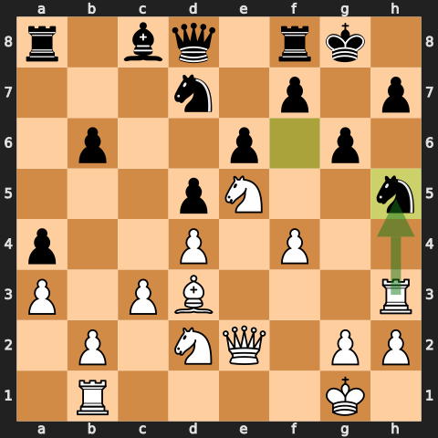
  
<strong>An attractive attack can still fail.</strong> After 17...Nh5: the played Rxh5 is a serious commitment. The game ended in a loss on time; the engine comparison separates the sacrifice from later play.

Stockfish supports Rxh5 in this exact position. A deeper illustrative line continues **20.Qxh5**, while the actual game uses **20.Bd3** and later ends in a loss on time. The stronger review still favors White after Bd3; that move is not an immediate losing error. The engine's evaluation favors White after the rook sacrifice; it does not claim a forced mate. The lost game does not refute the combination.

Compare these examples together. A winning result can conceal a defensive resource; a losing result can contain a sound attack. The repertoire should preserve the teaching idea while recording the tactical qualification. Exact searches and legal analysis branches are in the [Stockfish report](../sources/london-system-validation.md) and companion study.

## 13. Two first moves that change the repertoire

### Against 1…e5: take, develop, and be willing to return the pawn

Aman usually takes the Englund pawn, develops Nc3, then looks for e4, f4 and Nf3 if Black recovers on e5. [Part 5 gives the practical plan.](https://www.youtube.com/watch?v=0hlDcA0Zc9M&t=2118s)

  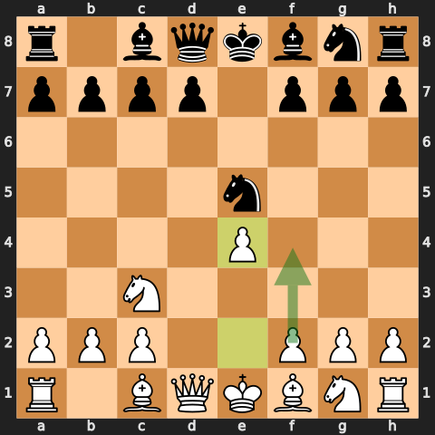
  
<strong>An Englund sideline is not a London.</strong> After 4.e4: White has returned the extra e5-pawn and developed with Nc3. Next f4 can gain time against Ne5.

Game 24 starts `1.d4 e5 2.dxe5 Nc6 3.Nc3 Nxe5 4.e4`. White returns the extra pawn and builds the centre; a later f4 can gain a tempo against the e5-knight. The position remains tactical: ...Qh4, checks on b4 and pressure on f2 still need attention.

This is one response to the Englund, not a complete analysis of all Black's alternatives. If Black does not recover the pawn immediately, use the board in front of you. Do not apply the next moves mechanically.

### Against 1…c5: d5 takes useful space

  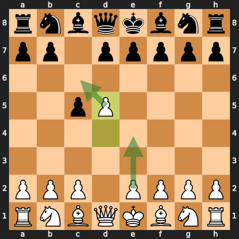
  
<strong>Against 1...c5: take the space.</strong> After 2.d5: the game has left the usual London. White can develop with e4, Nc3 and sometimes c4 rather than insist on Bf4.

Game 17 begins `1.d4 c5 2.d5`. White can develop a Benoni-type centre with e4 and Nc3, often adding c4. The game is part of the speedrun's White repertoire but is not a standard London. Aman recommends this practical change rather than insisting on Bf4 against every first move.

## 14. A practical study route

1. **Learn the two central setups.** Replay game 25 for c3/Nd2 and game 7 for c4/Nc3. Explain the pawn choice before playing a move.
2. **Add bishop safety.** Study games 11 and 60 together: h3/Bh2 in one, the queen's h5 diagonal in the other. Recheck the line after Nf3.
3. **Learn exchanges, not just development.** Compare games 14, 22 and 130. Identify the file, square or piece that improves after each recapture.
4. **Study queen pressure with the exceptions attached.** Replay game 58, then the game 31 correction. Only then examine the sharp games 112 and 123.
5. **Add the active fianchetto branches.** Compare games 59 and 63, then the loss in game 114. Identify Black's central break before considering h-pawn moves.
6. **Calculate both sacrifices.** At the diagrams from games 39 and 66, write a defense for Black before opening the analysis. Include king escapes, exchanges and central counterplay.
7. **Practice conversion.** Select an extra-pawn ending from the full collection and play it against resistance. An opening advantage still needs a clock and a finish.

For a first pass, the 22 study chapters provide compact positions to replay or import into a chess study tool. Use the complete PGN when you want to understand how the middlegame actually unfolded. The game numbers agree across the guide, index, diagram manifest and engine record.

## 15. Your between-moves checklist

- What has Black changed in the centre: …c5, …c4, …e5, or an exchange on d4?
- Does my c-pawn belong on c3 or c4, and where does that put the b1-knight?
- Is my f4-bishop threatened, and is a retreat better than an exchange?
- Is the queen still watching h5, or has one of my own pieces blocked the line?
- What will be left after the next pawn exchange? Count the pawns and open files.
- Before a sacrifice, where can the king move forward, and what can Black exchange?
- If the attack wins material rather than mate, can I change to a simpler conversion?
